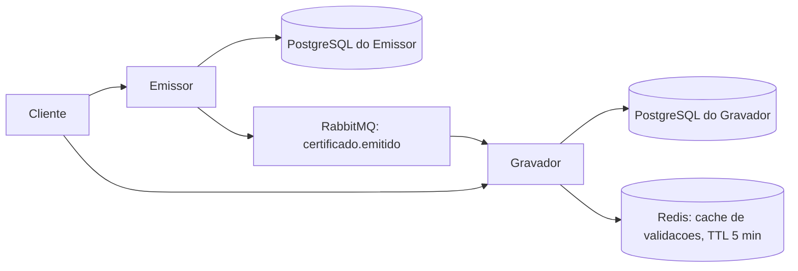

# API de Emissao de Certificados

Projeto em Java 17 e Spring Boot para emitir certificados de forma assincrona e disponibilizar sua validacao. Esta primeira versao usa o **perfil A: Docker Compose**.

## O que o sistema faz

1. O **Emissor** recebe os dados do participante e do curso, grava o certificado no seu proprio PostgreSQL e publica um evento na fila `certificado.emitido`.
2. O **Gravador** consome o evento e registra o certificado no PostgreSQL dele. O identificador do evento e unico; mensagens repetidas nao criam outro registro.
3. O Gravador permite consultar o certificado pelo ID ou pelo codigo de validacao. O Redis guarda apenas consultas encontradas por ate **5 minutos**. As entradas expiram automaticamente e sao invalidadas quando o Gravador processa um evento correspondente.

O Emissor grava o certificado e o evento pendente no mesmo banco e transacao. Um publicador envia o outbox ao RabbitMQ e so marca o evento como publicado depois da confirmacao do broker. O Gravador confirma a mensagem depois de concluir a gravacao; uma falha pode causar reentrega, mas nao perda silenciosa. O `eventId` e uma chave unica no banco do Gravador, tornando o processamento idempotente.

## Testar pelo Postman

Importe [`postman/Certificado-API.postman_collection.json`](postman/Certificado-API.postman_collection.json) no Postman. Com os servicos iniciados por Docker Compose, execute as requisicoes nesta ordem:

1. **Emitir certificado**: envia um exemplo ao Emissor (`localhost:8080`) e salva automaticamente o ID e o codigo retornados nas variaveis da colecao.
2. **Consultar certificado por ID** ou **por codigo de validacao**: consulta o Gravador (`localhost:8081`). Como a fila e assincrona, aguarde alguns segundos e tente novamente se a mensagem ainda nao tiver sido processada.
3. **Consultar codigo inexistente (espera 404)**: confirma que uma consulta desconhecida retorna `404 Not Found` e nao e guardada no cache.

As variaveis `emissorUrl` e `gravadorUrl` estao definidas na colecao e podem ser alteradas para outros enderecos locais.

## Testar entrega repetida pelo RabbitMQ

1. Abra `http://localhost:15672` e entre com o usuario `certificado` e a senha local `local-dev-only` (ou os valores configurados em `RABBITMQ_USER` e `RABBITMQ_PASSWORD`).
2. Em **Exchanges**, abra **(AMQP default)** e expanda **Publish message**. Use routing key `certificado.emitido`, propriedade `content_type` com valor `application/json` e este cabecalho:

   ```json
   {
     "__TypeId__": "com.sergio.certificado.contract.CertificateIssuedEvent"
   }
   ```

3. Use o mesmo payload abaixo nas duas publicacoes. Mantenha os mesmos `eventId` e `certificateId`; eles identificam a mensagem e o certificado de teste.

   ```json
   {
     "eventId": "f70e82b2-b6ac-4cd7-97f6-8a8ca864aa01",
     "certificateId": "f70e82b2-b6ac-4cd7-97f6-8a8ca864aa02",
     "validationCode": "teste-reentrega-parte-2-0001",
     "participant": "Teste RabbitMQ",
     "course": "Entrega pelo menos uma vez",
     "issuedAt": "2026-11-22T00:00:00Z"
   }
   ```

4. Clique **Publish message** duas vezes, sem alterar payload ou cabecalhos. Aguarde o consumidor processar as mensagens; `messages_ready` deve voltar a zero.
5. No terminal, confirme que existe exatamente uma linha para o evento:

   ```powershell
   docker compose exec db-gravador psql -U certificado -d gravador -c "SELECT event_id, COUNT(*) FROM registered_certificates WHERE event_id = 'f70e82b2-b6ac-4cd7-97f6-8a8ca864aa01' GROUP BY event_id;"
   ```

   O resultado deve mostrar `count = 1`. O mesmo `eventId` repetido e reconhecido sem gravar uma segunda linha.

## Desenho



Os servicos nao compartilham banco de dados. A comunicacao entre eles ocorre pela fila.

## Como rodar — perfil A

Requisitos: Docker Engine ou Docker Desktop com o daemon iniciado e Docker Compose v2.

Na raiz do projeto:

```powershell
docker compose up --build
```

Para encerrar:

```powershell
docker compose down
```

Para encerrar e apagar os dados locais dos bancos e do Redis:

```powershell
docker compose down -v
```

Os bancos, RabbitMQ e Redis ficam acessiveis nas portas `5433`, `5434`, `5672`, `15672` e `6379`. A interface de gerenciamento do RabbitMQ fica em `http://localhost:15672` (usuario e senha locais definidos no `compose.yaml`). O Emissor fica em `http://localhost:8080`; o Gravador, em `http://localhost:8081`.

### Emitir um certificado

```powershell
curl.exe -X POST http://localhost:8080/api/certificados `
  -H "Content-Type: application/json" `
  -d '{"participante":"Ana Silva","curso":"Introducao a APIs"}'
```

O endpoint retorna `202 Accepted` com o identificador e o codigo de validacao. O registro no Gravador e assincrono; consulte novamente se o evento ainda estiver na fila:

```powershell
curl.exe http://localhost:8081/api/validacoes/CODIGO_RETORNADO
curl.exe http://localhost:8081/api/certificados/ID_RETORNADO
```

## Testes

Com Java 17 ou superior e o daemon Docker ativo:

```powershell
.\mvnw.cmd test
```

Os testes unitarios nao precisam de infraestrutura externa. Os testes de integracao com RabbitMQ, Redis e PostgreSQL serao adicionados em etapas posteriores.

## Decisoes

As decisoes de arquitetura e as alternativas consideradas estao em [docs/adr/](docs/adr/).
