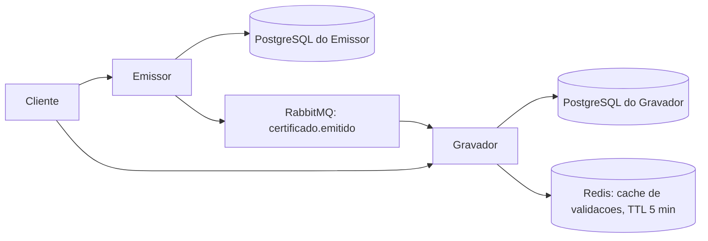

# API de Emissao de Certificados

Projeto em Java 17 e Spring Boot para emitir certificados de forma assincrona e disponibilizar sua validacao. Esta primeira versao usa o **perfil A: Docker Compose**.

## O que o sistema faz

1. O **Emissor** recebe os dados do participante e do curso, grava o certificado no seu proprio PostgreSQL e publica um evento na fila `certificado.emitido`.
2. O **Gravador** consome o evento e registra o certificado no PostgreSQL dele. O identificador do evento e unico; mensagens repetidas nao criam outro registro.
3. O Gravador permite consultar o certificado pelo codigo de validacao. O Redis guarda consultas encontradas por ate **5 minutos**. A entrada e removida quando o Gravador processa um evento daquele codigo e tambem expira automaticamente ao fim do prazo.

O Gravador confirma a mensagem ao RabbitMQ somente depois de concluir o processamento. A deduplicacao no banco protege contra reentregas da fila.

## Desenho



Os servicos nao compartilham banco de dados. A comunicacao entre eles ocorre pela fila.

## Como rodar — perfil A

Requisitos: Docker Engine ou Docker Desktop com o daemon iniciado e Docker Compose v2.

Na raiz do projeto:

```powershell
docker compose up --build
```

Para encerrar:

```powershell
docker compose down
```

Para encerrar e apagar os dados locais dos bancos e do Redis:

```powershell
docker compose down -v
```

Os bancos, RabbitMQ e Redis ficam acessiveis nas portas `5433`, `5434`, `5672`, `15672` e `6379`. A interface de gerenciamento do RabbitMQ fica em `http://localhost:15672` (usuario e senha locais definidos no `compose.yaml`). O Emissor fica em `http://localhost:8080`; o Gravador, em `http://localhost:8081`.

### Emitir um certificado

```powershell
curl.exe -X POST http://localhost:8080/api/certificados `
  -H "Content-Type: application/json" `
  -d '{"participante":"Ana Silva","curso":"Introducao a APIs"}'
```

O endpoint retorna `202 Accepted` com o identificador e o codigo de validacao. O registro no Gravador e assincrono; consulte novamente se o evento ainda estiver na fila:

```powershell
curl.exe http://localhost:8081/api/validacoes/CODIGO_RETORNADO
```

## Testes

Com Java 17 ou superior e o daemon Docker ativo:

```powershell
.\mvnw.cmd test
```

Os testes unitarios nao precisam de infraestrutura externa. Os testes de integracao com RabbitMQ, Redis e PostgreSQL serao adicionados em etapas posteriores.

## Decisoes

As decisoes de arquitetura e as alternativas consideradas estao em [docs/adr/](docs/adr/).
