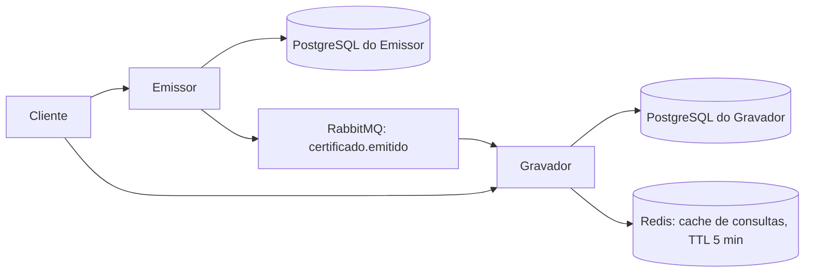

# API de Emissao de Certificados

Projeto didatico em Java 17 e Spring Boot para emitir certificados de forma assincrona e disponibilizar sua validacao. A aplicacao usa o **perfil A: Docker Compose**.

## O que o sistema faz

1. O **Emissor** recebe os dados do participante e do curso e grava o certificado no PostgreSQL dele.
2. Na mesma transacao, o Emissor registra um evento pendente no outbox. Um publicador envia o evento persistente ao RabbitMQ e so o marca como publicado depois da confirmacao do broker.
3. O **Gravador** consome a fila `certificado.emitido` e registra o certificado no PostgreSQL separado dele. A chave unica `eventId` impede que uma reentrega crie outra linha.
4. O Gravador permite consultar certificados por ID ou codigo de validacao. O Redis guarda apenas consultas encontradas por cinco minutos; entradas correspondentes sao invalidadas quando chega um evento.

## Arquitetura



Os servicos nao compartilham banco de dados. A entrega e **pelo menos uma vez**: uma mensagem pode ser reentregue, e a deduplicacao no banco do Gravador torna o processamento idempotente.

## Requisitos

- Windows com PowerShell (os comandos abaixo usam sintaxe PowerShell).
- Docker Desktop instalado e iniciado, com Docker Compose v2 (`docker compose`).
- Portas locais `5433`, `5434`, `5672`, `6379`, `8080`, `8081` e `15672` livres.
- Para rodar os testes Maven fora do Docker: Java 17 ou superior, com `JAVA_HOME` apontando para essa instalacao.

## Como iniciar do zero

Clone o repositorio e entre na pasta do projeto:

```powershell
git clone https://github.com/spatricio/certificado-api.git
Set-Location certificado-api
```

Na raiz do repositorio, construa as imagens e inicie os servicos em segundo plano:

```powershell
docker compose up --build -d
docker compose ps
```

Espere ate os bancos, RabbitMQ e Redis ficarem `healthy`, e os servicos `emissor` e `gravador` ficarem `running`. Os containers da aplicacao podem aparecer como `running` antes de o Spring Boot terminar de iniciar. Acompanhe os logs:

```powershell
docker compose logs -f emissor gravador
```

Quando aparecer `Started EmissorApplication` e `Started GravadorApplication`, pressione `Ctrl+C` para sair da exibicao dos logs; os containers continuarao rodando. O primeiro build pode levar alguns minutos para baixar as imagens e dependencias.

| Componente | Endereco local |
|---|---|
| Emissor | `http://localhost:8080` |
| Gravador | `http://localhost:8081` |
| Painel RabbitMQ | `http://localhost:15672` |
| PostgreSQL do Emissor | `localhost:5433` |
| PostgreSQL do Gravador | `localhost:5434` |
| RabbitMQ AMQP | `localhost:5672` |
| Redis | `localhost:6379` |

O painel RabbitMQ usa `certificado` / `local-dev-only` por padrao. Esses valores sao apenas para desenvolvimento local; podem ser substituidos por `RABBITMQ_USER` e `RABBITMQ_PASSWORD`. O usuario e senha dos bancos tambem podem ser alterados com `POSTGRES_USER` e `POSTGRES_PASSWORD`.

## Testar a emissao e as consultas

Em um terminal PowerShell na raiz do repositorio, emita um certificado:

```powershell
$emissao = Invoke-RestMethod `
  -Method Post `
  -Uri "http://localhost:8080/api/certificados" `
  -ContentType "application/json" `
  -Body (@{ participante = "Ana Silva"; curso = "Introducao a APIs" } | ConvertTo-Json)

$emissao
```

O Emissor responde `202 Accepted` com `id` e `codigoValidacao`. Como a fila e assincrona, espere alguns segundos e consulte o Gravador. Se o evento ainda nao foi processado, a consulta retorna `404`; tente novamente depois de aguardar.

```powershell
Start-Sleep -Seconds 2
Invoke-RestMethod "http://localhost:8081/api/certificados/$($emissao.id)"
Invoke-RestMethod "http://localhost:8081/api/validacoes/$($emissao.codigoValidacao)"
```

Uma busca bem-sucedida e armazenada no Redis por cinco minutos. Respostas `404` nao sao cacheadas. Para repetir os testes de forma guiada, importe [`postman/Certificado-API.postman_collection.json`](postman/Certificado-API.postman_collection.json) no Postman e execute primeiro **Emitir certificado**, depois as consultas.

## Testar deduplicacao pela interface do RabbitMQ

1. Abra `http://localhost:15672` e entre com `certificado` / `local-dev-only` (ou os valores configurados no ambiente).
2. Em **Exchanges**, abra **(AMQP default)** e expanda **Publish message**. Use routing key `certificado.emitido`, propriedade `content_type` com valor `application/json` e o cabecalho:

   ```json
   {
     "__TypeId__": "com.sergio.certificado.contract.CertificateIssuedEvent"
   }
   ```

3. Publique o mesmo payload duas vezes, sem alterar `eventId` nem `certificateId`:

   ```json
   {
     "eventId": "f70e82b2-b6ac-4cd7-97f6-8a8ca864aa01",
     "certificateId": "f70e82b2-b6ac-4cd7-97f6-8a8ca864aa02",
     "validationCode": "teste-reentrega-parte-2-0001",
     "participant": "Teste RabbitMQ",
     "course": "Entrega pelo menos uma vez",
     "issuedAt": "2026-11-22T00:00:00Z"
   }
   ```

4. Aguarde o consumidor processar as mensagens. Em **Queues and Streams**, a fila `certificado.emitido` deve voltar a zero mensagens prontas.
5. Em outro terminal PowerShell, confirme que o evento foi gravado uma vez:

   ```powershell
   docker compose exec db-gravador psql -U certificado -d gravador -c "SELECT event_id, COUNT(*) FROM registered_certificates WHERE event_id = 'f70e82b2-b6ac-4cd7-97f6-8a8ca864aa01' GROUP BY event_id;"
   ```

   O resultado deve mostrar `count = 1`. Se repetir o teste em um ambiente que ja contem esse evento, a linha existente continuara sendo unica.

## Testes automatizados

Com Java 17 ou superior instalado e `JAVA_HOME` configurado:

```powershell
.\mvnw.cmd test
```

Os testes unitarios nao exigem Docker nem servicos externos. Os testes de integracao entre processos/infraestrutura ainda nao fazem parte desta etapa.

## Encerrar

Pare os containers e mantenha os dados para a proxima execucao:

```powershell
docker compose down
```

Para apagar tambem os dados locais dos bancos e do Redis:

```powershell
docker compose down -v
```

> **Atencao:** `down -v` apaga os dados persistidos localmente.

## Decisoes e apresentacao

As alternativas e justificativas estao em [docs/adr/](docs/adr/). O roteiro de demonstracao e perguntas para a banca esta em [docs/roteiro-apresentacao.md](docs/roteiro-apresentacao.md).
